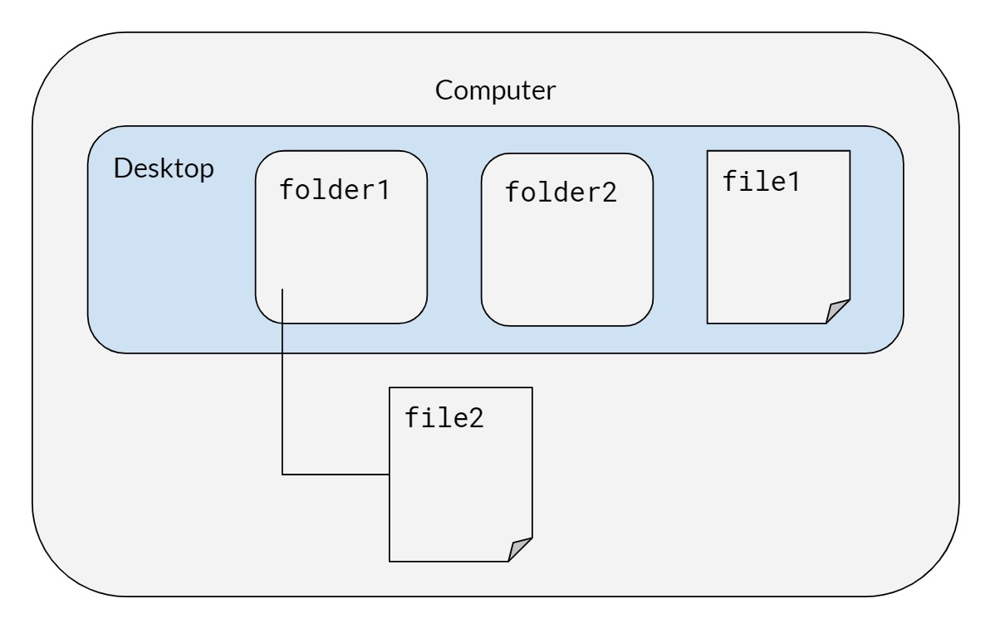
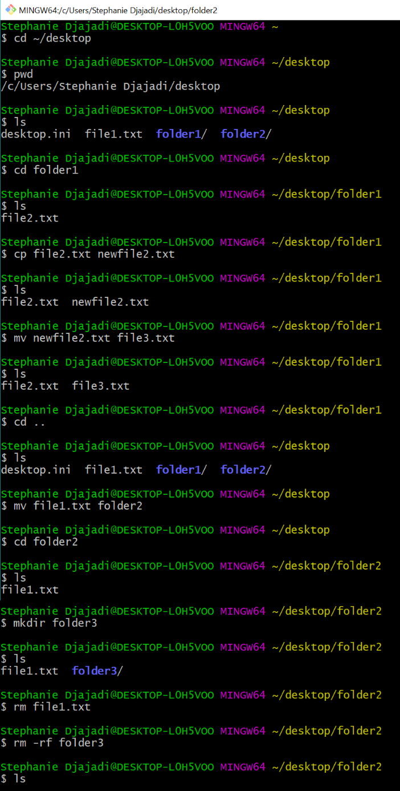

# Unix

Code

Published

Last modified: 2026-10-12 00:44:34 (PDT)

We typically use Unix commands in Terminal (for Mac users) or Git Bash (for Windows users) to

1.  Run a series of scripts in parallel or in a specific order to reproduce our work
2.  To check on the progress of a batch of jobs
3.  To use git and push to github

## 1 User interfaces: CLI, TUI, and GUI

Software tools expose different interaction models depending on whether they run in a terminal or a desktop window. Understanding the trade-offs between Command-Line Interfaces (CLIs), Terminal User Interfaces (TUIs), and Graphical User Interfaces (GUIs) helps developers choose the right tool for local development, remote server administration, and automated analysis pipelines.

### 1.1 Command-line interfaces (CLI)

A Command-Line Interface (CLI) processes discrete text commands typed into a shell prompt. Commands execute sequentially, read arguments and configuration flags, and stream output to standard output (`stdout`) or standard error (`stderr`).

Key characteristics:

- **Scriptable and composable:** Commands can be chained with Unix pipes (`|`), redirected to files (`>`), and automated in shell scripts or CI/CD pipelines without human interaction.
- **Stateless execution:** Each command runs to completion and exits, returning control to the prompt.
- **Low overhead:** Requires minimal system memory and CPU, making it suitable for headless servers and high-performance computing (HPC) nodes.
- **Steep initial learning curve:** Users must memorize command syntax, flags, and arguments or consult manual pages (`man`) and `--help` output.

Common data science examples: `git`, `quarto`, `Rscript`, `curl`, and `gh`.

### 1.2 Terminal user interfaces (TUI)

A Terminal User Interface (TUI)—also called a text-based user interface—provides an interactive visual layout rendered entirely inside a text terminal. TUIs draw panels, borders, menus, and color highlights using ASCII or ANSI text grids rather than native windowing frameworks.

Key characteristics:

- **Interactive visual dashboards:** Displays real-time lists, split views, and scrollable panels while remaining inside the terminal.
- **Keyboard-driven efficiency:** Operates entirely via rapid keyboard shortcuts, avoiding mouse context-switching.
- **Full SSH and multiplexer compatibility:** Runs seamlessly over lightweight SSH connections and inside terminal multiplexers like `tmux` without X11 forwarding or browser overhead.
- **Terminal constraints:** Cannot display arbitrary high-resolution images or interactive plots without specialized terminal graphics extensions.

Common developer examples: `lazygit` (interactive Git client), `htop` / `btop` (interactive system process monitors), `ranger` (terminal file manager), and `tig` (text-mode Git repository browser).

### 1.3 Graphical user interfaces (GUI)

A Graphical User Interface (GUI) presents visual controls such as windows, buttons, menus, and dialog boxes, typically navigated using a mouse pointer and keyboard shortcuts.

Key characteristics:

- **High discoverability:** Menus, toolbars, and visual forms expose available actions without requiring users to memorize commands in advance.
- **Rich multi-panel layouts:** Enables simultaneous side-by-side inspection of plots, data tables, code editors, and environment variables.
- **Difficult to automate:** Actions taken by clicking buttons cannot be trivially replayed in batch pipelines unless the application provides an underlying scripting API.
- **Remote latency and display requirements:** Running a remote GUI requires an active graphical display server, such as X11 forwarding (see [X11 Forwarding](https://ucd-serg.github.io/lab-manual/slurm.html#sec-x11-forwarding)) or a web-based portal like RStudio Server on Mercury.

Common data science examples: RStudio, VS Code, GitHub Desktop, and GitKraken.

### 1.4 Summary and trade-offs

| Interface | Primary interaction | Visual feedback | Automation / Scripting | Remote SSH performance | Primary use case |
|----|----|----|----|----|----|
| **CLI** | Text commands and flags | Sequential text streams | High (shell scripts, CI pipelines) | Excellent (native text) | Automated batch jobs, pipelines, scripting |
| **TUI** | Keyboard navigation and hotkeys | Interactive terminal dashboard | Low to moderate | Excellent (runs directly in shell or `tmux`) | Remote server inspection, fast staging, system monitoring |
| **GUI** | Mouse pointer and keyboard shortcuts | Windows, menus, graphic plots | Low | Requires X11 or web server | Exploratory analysis, visual editing, multi-panel IDEs |

Table 1: Comparison of CLI, TUI, and GUI interface models

In research computing, the three paradigms complement one another. A typical workflow uses a **GUI** (such as RStudio) for exploratory analysis and visualization, a **TUI** (such as `lazygit` or `htop`) for managing version control and monitoring remote cluster jobs, and a **CLI** (such as `quarto render` or `Rscript`) for reproducible scripts and automated pipelines.

## 2 Basics

On the computer, there is a desktop with two folders, `folder1` and `folder2`, and a file called `file1.` Inside `folder1`, we have a file called `file2.` Mac users can run these commands on their terminal; it is recommended that Windows users use Git Bash, not Windows PowerShell.

[](../assets/images/ex-desktop.jpg "Figure 1: Example desktop with folders and files")

Figure 1: Example desktop with folders and files

## 3 Terminal Emulators

A terminal emulator is the application window that runs your shell (such as `zsh`, `bash`, or `fish`). While macOS ships with Terminal.app and Windows includes Command Prompt, modern terminal emulators provide significant advantages:

- **GPU acceleration**: Rendering text on the GPU keeps scrolling and large output streams smooth and responsive.
- **Modern font rendering**: Full support for true color, ligatures, and powerline or nerd font symbols.
- **Window management**: Native support for tabs, split panes, and multiple windows without requiring a separate multiplexer like `tmux`.
- **Cross-platform consistency**: Several modern emulators use identical configuration files across macOS, Linux, and Windows.

### 3.1 Recommended Options

#### [Ghostty](https://ghostty.org/)

Ghostty is a fast, GPU-accelerated terminal emulator developed by Mitchell Hashimoto. It focuses on native platform integration, performance, and rich terminal features:

- Native user interface on macOS and Linux
- Cross-platform configuration using a simple plain-text configuration file
- Built-in tabs and split panes
- True color and modern terminal graphics protocol support
- Available on macOS and Linux (Windows support in active development as of September 2026)

#### [WezTerm](https://wezfurlong.org/wezterm/)

WezTerm is a GPU-accelerated terminal emulator and multiplexer written in Rust:

- Configured using Lua, enabling powerful custom keybindings and automation scripts
- Built-in multiplexing across tabs, splits, and workspaces
- Support for SSH domains to seamlessly reconnect to remote servers
- Rich graphics support including iTerm2 and Sixel image protocols
- Cross-platform support on macOS, Linux, and Windows

#### [Alacritty](https://alacritty.org/)

Alacritty is a minimalist, GPU-accelerated terminal emulator written in Rust:

- Focused strictly on raw rendering speed and simplicity
- Configured using TOML
- Omits built-in tabs and split panes by design; often paired with `tmux` for multiplexing
- Cross-platform support on macOS, Linux, and Windows

#### [Kitty](https://sw.kovidgoyal.net/kitty/)

Kitty is a GPU-accelerated terminal emulator designed for keyboard-driven power users:

- Rich graphics protocol for rendering images directly in the terminal
- Built-in support for window layouts, tabs, and startup sessions
- Configured via plain text configuration files
- Highly scriptable from the command line
- Available on Linux and macOS

#### [iTerm2](https://iterm2.com/)

iTerm2 is a mature, feature-packed terminal emulator built specifically for macOS:

- Extensive GUI settings alongside scriptable configuration
- Native split panes, tab management, and search features
- Rich shell integration, inline image support, and paste history
- Available exclusively on macOS

#### [Windows Terminal](https://github.com/microsoft/terminal)

Windows Terminal is a modern, high-performance terminal emulator developed by Microsoft:

- GPU-accelerated text rendering engine (Direct3D-based AtlasEngine)
- Tabbed interface supporting multiple shells simultaneously (PowerShell, Command Prompt, Git Bash, and WSL)
- Customizable themes, color schemes, and keybindings via GUI or JSON
- Available on Windows 10 and Windows 11

### 3.2 Comparison Summary

| Terminal Emulator | Platforms | GPU Accelerated | Built-in Tabs/Splits | Configuration |
|----|----|----|----|----|
| [Ghostty](https://ghostty.org/) | macOS, Linux | Yes | Yes | Plain text |
| [WezTerm](https://wezfurlong.org/wezterm/) | macOS, Linux, Windows | Yes | Yes | Lua |
| [Alacritty](https://alacritty.org/) | macOS, Linux, Windows | Yes | No (use `tmux`) | TOML |
| [Kitty](https://sw.kovidgoyal.net/kitty/) | macOS, Linux | Yes | Yes | Plain text |
| [iTerm2](https://iterm2.com/) | macOS | Yes | Yes | GUI / Property list |
| [Windows Terminal](https://github.com/microsoft/terminal) | Windows | Yes | Yes | JSON / GUI |

Table 2: Modern terminal emulator comparison

## 4 Syntax for both Mac/Windows

When typing in directories or file names, quotes are necessary if the name includes spaces.

| Command | Description |
|----|----|
| `cd desktop/folder1` | Change directory to `folder1` |
| `pwd` | Print working directory |
| `ls` | List files in the directory |
| `cp "file2" "newfile2"` | Copy file (remember to include file extensions when typing in file names like `.pdf` or `.R`) |
| `mv "newfile2" "file3"` | Rename `newfile2` to `file3` |
| `cd ..` | Go to parent of the working directory (in this case, `desktop`) |
| `mv "file1" folder2` | Move `file1` to `folder2` |
| `mkdir folder3` | Make a new folder in `folder2` |
| `rm <filename>` | Remove files |
| `rm -rf folder3` | Remove directories (`-r` will attempt to remove the directory recursively, `-rf` will force removal of the directory) |
| `clear` | Clear terminal screen of all previous commands |

Table 3: Basic Unix commands for Mac and Windows

[](../assets/images/ex-terminal.PNG "Figure 2: Terminal output after executing basic Unix commands")

Figure 2: Terminal output after executing basic Unix commands

## 5 Zsh and Oh My Zsh

The commands in the tables above work the same in any shell. This section is about which shell to use *interactively* — the one that gives you a prompt, completes filenames, and remembers your history. It does not change how scripts run: a script beginning `#!/usr/bin/env bash` still runs under bash no matter which shell you launched it from.

We recommend Z shell (`zsh`) with [Oh My Zsh](https://ohmyz.sh/), a configuration framework that supplies themes, completions, and a plugin system. Two reasons:

- `zsh` has been the default login shell on macOS since 10.15 (Catalina), so most of the lab is already running it.
- The plugin pair below — suggestions from your own history, and syntax coloring that shows a typo before you press enter — removes a real class of command-line mistake.

This applies to macOS, Linux, and Windows Subsystem for Linux (WSL). It does not apply to Git Bash on Windows, which is bash and has no `zsh` to switch to; Windows users who want this should work inside WSL.

### 5.1 Installing zsh

Check whether you already have it:

``` bash
zsh --version
```

If that errors, install it (`brew install zsh` on macOS, `sudo apt install zsh` on Ubuntu and WSL), then make it your login shell:

``` bash
chsh -s "$(command -v zsh)"
```

`chsh` prompts for your own password, and refuses any shell not listed in `/etc/shells`. An `apt` install registers itself there; a Homebrew build does not, so append its path first:

``` bash
command -v zsh | sudo tee -a /etc/shells
```

The change takes effect at your next login, so open a new terminal and confirm with `echo $SHELL`. On WSL, close every window for that distribution first — or run `wsl --terminate <distro>` from PowerShell — since the shell is chosen when the distribution starts.

### 5.2 Installing Oh My Zsh

``` bash
sh -c "$(curl -fsSL https://raw.githubusercontent.com/ohmyzsh/ohmyzsh/master/tools/install.sh)"
```

The installer clones the framework to `~/.oh-my-zsh`, replaces `~/.zshrc` with its own template, and backs up whatever was there to `~/.zshrc.pre-oh-my-zsh`. Check that backup for anything worth carrying forward before you delete it. If you would rather it not touch your login shell or drop you into `zsh` immediately, run it unattended instead:

``` bash
sh -c "$(curl -fsSL https://raw.githubusercontent.com/ohmyzsh/ohmyzsh/master/tools/install.sh)" "" --unattended
```

The empty `""` is not a typo. `sh -c` treats the argument after the script as `$0`, so without a placeholder there `--unattended` would be consumed as the script’s own name instead of reaching it as a flag. The installer’s header documents that flag as setting both `CHSH` and `RUNZSH` to `no`, which leaves the `chsh` step above to you.

### 5.3 The two plugins we use

[`zsh-autosuggestions`](https://github.com/zsh-users/zsh-autosuggestions) proposes the rest of a command in gray as you type it, drawn from your history; press the right arrow to accept it. [`zsh-syntax-highlighting`](https://github.com/zsh-users/zsh-syntax-highlighting) colors the command line as you type — a command that does not exist stays red, so a misspelled `git ceckout` is visible before you run it.

Neither ships with Oh My Zsh, so clone both into its custom-plugin directory:

``` bash
git clone https://github.com/zsh-users/zsh-autosuggestions \
  "${ZSH_CUSTOM:-$HOME/.oh-my-zsh/custom}/plugins/zsh-autosuggestions"
git clone https://github.com/zsh-users/zsh-syntax-highlighting \
  "${ZSH_CUSTOM:-$HOME/.oh-my-zsh/custom}/plugins/zsh-syntax-highlighting"
```

Then enable them in `~/.zshrc`. Oh My Zsh’s template ships `plugins=(git)`, so the line below is that default plus the two — if you have already added others, append to your list rather than pasting over it:

``` bash
plugins=(git zsh-autosuggestions zsh-syntax-highlighting)
```

**Keep `zsh-syntax-highlighting` last.** Its own installation guide states that it “must be the last plugin sourced”. The reason, from its FAQ, is that it hooks into the Zsh Line Editor, and those hooks run in the order they were registered — so it has to register after anything else that modifies the command-line buffer. The failure is quiet: a widget added by a later plugin still works, it just stops updating the highlighting, with no error to tell you why.

Open a new terminal, or run `exec zsh`, to load the changes.

### 5.4 More plugins, at no install cost

The two above had to be cloned because they live outside Oh My Zsh. Oh My Zsh itself ships several hundred plugins that are already on disk — adding a name to `plugins=()` is the whole installation. Run `ls ~/.oh-my-zsh/plugins` to see the full list. These are the ones that earn their place for the work this guide describes:

| Plugin | What it gives you |
|----|----|
| `gh` | Completions for the GitHub CLI, which our workflow leans on heavily |
| `tmux` | Aliases for the `tmux` session commands this chapter uses for long-running jobs |
| `extract` | `x <file>` unpacks any archive, so you stop looking up `tar` flags |
| `command-not-found` | On Ubuntu and WSL, names the package that would supply a missing command |
| `history-substring-search` | Type a prefix, then press up to walk only the history entries that match |
| `colored-man-pages` | Syntax coloring in `man`, which matters most in the long pages |
| `safe-paste` | Holds a pasted command with a trailing newline instead of running it unread |
| `sudo` | Press escape twice to prefix the current or previous command with `sudo` |

Table 4: Bundled Oh My Zsh plugins worth enabling

**`history-substring-search` is the documented exception to the ordering rule above.** Its own README says to load `zsh-syntax-highlighting` *before* it, which is the opposite of the “keep syntax-highlighting last” instruction, and both are correct. The plugin handles the overlap itself rather than leaving you to. Its source, at `~/.oh-my-zsh/plugins/history-substring-search/history-substring-search.zsh`, tests `ZSH_HIGHLIGHT_VERSION` inside its own redraw hook and, under the comment “If the zsh-syntax-highlighting plugin has been loaded … remove our hooks”, unregisters both of its hooks with `add-zle-hook-widget -d`. So put it last of all:

``` bash
plugins=(git zsh-autosuggestions zsh-syntax-highlighting history-substring-search)
```

Every plugin costs startup time, and a shell that takes a second to appear is one you will resent. Measure rather than guess, before and after a batch of additions:

``` bash
time zsh -i -c exit
```

### 5.5 Prompt themes

Oh My Zsh sets `ZSH_THEME="robbyrussell"` by default, which shows the working directory and the git branch. `ls ~/.oh-my-zsh/themes` lists the bundled alternatives. Two non-bundled options come up often enough to be worth describing honestly.

[Powerlevel10k](https://github.com/romkatv/powerlevel10k) is the one people are usually told to install: a fast, information-dense prompt with an interactive setup wizard.

``` bash
git clone --depth=1 https://github.com/romkatv/powerlevel10k \
  "${ZSH_CUSTOM:-$HOME/.oh-my-zsh/custom}/themes/powerlevel10k"
```

Set `ZSH_THEME="powerlevel10k/powerlevel10k"` and run `p10k configure`.

Install it knowing its status. As of 2026-08-17 its README opens with a notice in capitals: the project has very limited support, no new features are in the works, most bugs will go unfixed, and help requests will be ignored. The author’s position is that it does not need active maintenance to keep working — “if it works now for you, it’ll keep working” — which is a reasonable thing to rely on for a prompt, and a bad thing to rely on if you expect a bug you hit to be fixed.

[Starship](https://starship.rs/) is the actively developed alternative, written in Rust and configured through one `~/.config/starship.toml`:

``` bash
curl -sS https://starship.rs/install.sh | sh
```

Its distinguishing feature is that it is not a zsh theme at all — the same binary and the same config drive the prompt in bash, fish, PowerShell, and others. That matters if you move between a Mac laptop, a Linux server, and Git Bash on Windows, since one file follows you instead of three. Oh My Zsh bundles a `starship` plugin, so adding `starship` to `plugins=()` is the whole setup — the plugin unsets `ZSH_THEME` itself, and says so in a comment, so there is no leftover theme to remove by hand.

**Both want a Nerd Font, and this is the step people miss.** The prompts draw git status and other state with glyphs from the private-use area, which an unpatched font renders as boxes. Powerlevel10k’s wizard offers to install MesloLGS NF for you. The font is a setting of the terminal *emulator*, so on a remote machine it is configured on your own laptop and not on the server — installing fonts on Shiva will not fix boxes in your local terminal.

### 5.6 Command-line tools that pair with the shell

These are not zsh plugins, and they are most of what people mean when they say someone else’s terminal is nicer than theirs. Each stands alone; install the ones that answer a problem you actually have.

| Tool | What it replaces or adds |
|----|----|
| [`fzf`](https://github.com/junegunn/fzf) | Fuzzy interactive filtering, most usefully over history — enable the bundled `fzf` plugin to wire up its key bindings |
| [`ripgrep`](https://github.com/BurntSushi/ripgrep) (`rg`) | Recursive search that is fast on a large repo and skips what `.gitignore` names |
| [`fd`](https://github.com/sharkdp/fd) | `find` with defaults you would have wanted anyway |
| [`bat`](https://github.com/sharkdp/bat) | `cat` with syntax highlighting and paging |
| [`delta`](https://github.com/dandavison/delta) | Readable `git diff` and `git show` output, including word-level highlighting |
| [`direnv`](https://direnv.net/) | Per-directory environment variables, loaded on `cd` and unloaded on the way out |
| [`zoxide`](https://github.com/ajeetdsouza/zoxide) | `z <fragment>` jumps to a directory you visit often, instead of retyping the path |

Table 5: Command-line tools worth knowing about

`direnv` is the one with the most direct bearing on our own workflows: it is how a project can set `R_LIBS`, an API key, or a `RETICULATE_PYTHON` that applies inside that project and nowhere else. Oh My Zsh bundles `direnv` and `zoxide` plugins, so those two need no hook line in `~/.zshrc`.

### 5.7 Startup files, and what breaks when you switch

`zsh` does not read `~/.bashrc` or `~/.profile`. It reads `~/.zshenv` always, `~/.zprofile` at login, and `~/.zshrc` for every interactive shell — so anything you had accumulated in your bash startup files is simply gone the first time you log in under `zsh`.

The usual casualty is `PATH`. A line like

``` bash
export PATH="$HOME/.local/bin:$PATH"
```

sitting at the bottom of `~/.bashrc` is what puts locally installed tools on your path, and nothing warns you when it stops being read — the tool just reports as not found. Copy any such lines into `~/.zshrc` when you switch, and check that the commands you rely on still resolve:

``` bash
command -v quarto Rscript
```

## 6 Running Bash Scripts

| Windows | Mac / Linux | Description |
|----|----|----|
| `chmod +750 <filename.sh>` | `chmod +x <filename.sh>` | Change access permissions for a file (only needs to be done once) |
| `./<filename.sh>` | `./<filename.sh>` | Run file (`./` to run any executable file) |
| `bash bash_script_name.sh &` | `bash bash_script_name.sh &` | Run shell script in the background |

Table 6: Commands for running Bash scripts

## 7 Shell Scripting Style

For shell scripts, we follow the [Google Shell Style Guide](https://google.github.io/styleguide/shellguide.html) as the base authority, the same way our R chapters defer to the [tidyverse style guide](https://style.tidyverse.org/). The points below are the lab’s priorities and additions.

### 7.1 Error handling

Start every bash script with strict mode:

``` bash
#!/usr/bin/env bash
set -euo pipefail
```

- `set -e` exits when a command fails unhandled (it deliberately skips commands tested in an `if` or joined with `&&`/`||`), `set -u` errors on undefined variables, and `set -o pipefail` makes a pipeline fail when any stage fails, not just the last.
- Use a `trap ... EXIT` handler for cleanup (temporary files, lock release) so it runs on failure as well as success.
- Decide explicitly whether a step should fail the script (fail-closed) or log and continue (fail-open), and comment the choice when it isn’t obvious.

### 7.2 Functions and naming

Decompose scripts into functions the same way we decompose R code: small, single-purpose, and named in `snake_case`. Declare function-local variables with `local` so they don’t leak into the global namespace, and return status with `return` codes (write data results to stdout).

### 7.3 Comments

The same principle as our R guidance applies: explain *why*, not *what*. Keep inline comments brief, and point to an Architecture Decision Record for rationale too long for a comment (see [Design Documentation with ADRs](../chapters/coding-practices.llms.md#sec-adrs)).

### 7.4 Logging

Prefer a small log helper over scattered `echo` calls, so messages get a consistent format and severity level, and send diagnostics to stderr so stdout stays parseable:

``` bash
log() {
  local level=$1
  shift
  printf '%s [%s] %s\n' "$(date -u +%FT%TZ)" "$level" "$*" >&2
}
log INFO "starting import"
log ERROR "input file missing"
```

The `shift` / `$*` pair joins every argument after the severity into the message, so a message that reaches the function as several words is still logged whole. Callers should still quote the message (`log ERROR "..."`) — the shell expands globs and splits words *before* `log()` runs, so an unquoted message can be mangled on the way in.

### 7.5 Security

- Never echo secrets; redact tokens before logging command lines that carry them.
- Quote every variable expansion (`"$var"`, `"$@"`) to prevent word-splitting and glob surprises.
- Pass untrusted values to `jq` as arguments (`jq --arg name "$value"`), not by interpolating them into the filter string.
- Keep credentials out of `curl` command lines, where any local process can read them from the process list: prefer `--netrc` or headers read from a file (`--header @headers.txt`) over a token expanded into an argument.

### 7.6 Linting

[ShellCheck](https://www.shellcheck.net/) is the shell equivalent of [`{lintr}`](https://lintr.r-lib.org/): run `shellcheck script.sh` locally and in CI, and fix or explicitly disable (with a justifying comment) every finding. `bash -n script.sh` is a quick syntax-only check.

### 7.7 Portability

Decide whether a script targets bash or POSIX `sh`, and match the shebang to the decision: bash-specific features (arrays, `[[ ]]`, `local -n`) need `#!/usr/bin/env bash`, while scripts that must run on minimal CI images (BusyBox, Alpine `ash`) should stick to POSIX constructs and use `#!/bin/sh`. ShellCheck understands both and checks against the declared shell.

### 7.8 Formatting

Follow the same readability conventions as our R style: lines under about 80 characters, two-space indentation, and one logical step per line, breaking long pipelines after the `|` with the continuation indented.

## 8 Running Rscripts in Windows

**Note: This code seems to work only with Windows Command Prompt, not with Git Bash.**

When R is installed, it comes with a utility called Rscript. This allows you to run R commands from the command line. If Rscript is in your `PATH,` then typing Rscript into the command line, and pressing enter, will not error. Otherwise, to use Rscript, you will either need to add it to your PATH (as an environment variable), or append the full directory of the location of Rscript on your machine. To find the full directory, search for where R is installed your computer. For instance, it may be something like below (this will vary depending on what version of R you have installed):

`C:\Program Files\R\R-3.6.0\bin`

For appending the `PATH` variable, please view [this link](https://www.howtogeek.com/118594/how-to-edit-your-system-path-for-easy-command-line-access/). I strongly recommend completing this option.

If you add the PATH as an environment variable, then you can run this line of code to test: `Rscript -e "cat('this is a test')"`, where the `-e` flag refers to the expression that will be executed.

If you do not add the PATH as an environment variable, then you can run this line of code to replicate the results from above: `"C:\Program Files\R\R-3.6.0\bin\Rscript.exe" -e "cat('this is a test')"`

To run an R script from the command line, we can say: `Rscript -e "source('C:/path/to/script/some_code.R')"`

### 8.1 Common Mistakes

- Remember to include all of the quotation marks around file paths that have a spaces.
- If you attempt to run an R script but run into `Error: '\U' used without hex digits in character string starting "'C:\U"`, try replacing all `\` with `\\` or `/`.

## 9 Checking tasks and killing jobs

| Windows | Mac / Linux | Description |
|----|----|----|
| `tasklist` | `ps -v` | List all processes on the command line |
|  | `top -o [cpu/rsize]` | List all running processes, sorted by CPU or memory usage |
| `taskkill /F /PID pid_number` | `kill <PID_number>` | Kill a process by its process ID |
| `taskkill /IM "process name" /F` |  | Kill a process by its name |
| `start /b program.exe` |  | Runs jobs in the background (exclude `/b` if you want the program to run in a new console) |
|  | `nohup` | Prevents jobs from stopping |
|  | `disown` | Keeps jobs running in the background even if you close R |
| `taskkill /?` |  | Help, lists out other commands |

To kill a task in Windows, you can also go to Task Manager \> More details \> Select your desired app \> Click on End Task.

## 10 Running big jobs

For big data workflows, the concept of “backgrounding” a bash script allows you to start a “job” (i.e. run the script) and leave it overnight to run. At the top level, a bash script (`0-run-project.sh`) that simply calls the directory-level bash scripts (i.e. `0-prep-data.sh`, `0-run-analysis.sh`, `0-run-figures.sh`, etc.) is a powerful tool to rerun every script in your project. See the included example bash scripts for more details.

- **Running Bash Scripts in Background**: Running a long bash script is not trivial. Normally you would run a bash script by opening a terminal and typing something like `./run-project.sh`. But what if you leave your computer, log out of your server, or close the terminal? Normally, the bash script will exit and fail to complete. To run it in background, type `./run-project.sh &; disown`. You can see the job running (and CPU utilization) with the command `top` or `ps -v` and check your memory with `free -h`.

Alternatively, to keep code running in the background even when an SSH connection is broken, you can use `tmux`. In terminal or gitbash follow the steps below. This [site](https://medium.com/@jeongwhanchoi/install-tmux-on-osx-and-basics-commands-for-beginners-be22520fd95e) has useful tips on using `tmux`.

``` bash
# create a new tmux session called session_name
tmux new -ssession_name

# run your job of interest
R CMD BATCH myjob.R & 
  
# check that it is running
ps -v

# to exit the tmux session (Mac)
ctrl + b 
d

# to reopen the tmux session to kill the job or 
# start another job
tmux attach -tsession_name 
```

- **Deleting Previously Computed Results**: One helpful lesson we’ve learned is that your bash scripts should remove previous results (computed and saved by scripts run at a previous time) so that you never mix results from one run with a previous run. This can happen when an R script errors out before saving its result, and can be difficult to catch because your previously saved result exists (leading you to believe everything ran correctly).

- **Ensuring Things Ran Correctly**: You should check the `.Rout` files generated by the R scripts run by your bash scripts for errors once things are run. A utility file is include in this repository, called `runFileSaveLogs`, and is used by the example bash scripts to… run files and save the generated logs. It is an awesome utility and one I definitely recommend using. Before using `runFileSaveLogs`, it is necessary to put the file in the home working directory. For help and documentation, you can use the command `./runFileSaveLogs -h`. See example code and example usage for `runFileSaveLogs` below.

### 10.1 Example code for `runfileSaveLogs`

``` python
#!/usr/bin/env python3
# Type "./runFileSaveLogs -h" for help

import os
import sys
import argparse
import getpass
import datetime
import shutil
import glob
import pathlib

# Setting working directory to this script's current directory
os.chdir(os.path.dirname(os.path.abspath(__file__)))

# Setting up argument parser
parser = argparse.ArgumentParser(description='Runs the argument R script(s) - in parallel if specified - and moves the subsequent generated .Rout log files to a timestamped directory.')

# Function ensuring that the file is valid
def is_valid_file(parser, arg):
    if not os.path.exists(arg):
        parser.error("The file %s does not exist!" % arg)
    else:
        return arg

# Function ensuring that the directory is valid
def is_valid_directory(parser, arg):
    if not os.path.isdir(arg):
        parser.error("The specified path (%s) is not a directory!" % arg)
    else:
        return arg

# Additional arguments that can be added when running runFileSaveLogs
parser.add_argument('-p', '--parallel', action='store_true', help="Runs the argument R scripts in parallel if specified")
parser.add_argument("-i", "--identifier", help="Adds an identifier to the directory name where this is saved")
parser.add_argument('filenames', nargs='+', type=lambda x: is_valid_file(parser, x))

args = parser.parse_args()
args_dict = vars(args)

print(args_dict)

# Run given R Scripts
for filename in args_dict["filenames"]:
  system_call = "R CMD BATCH" + " " + filename
  if args_dict["parallel"]: 
    system_call = "nohup" + " " + system_call + " &"

  os.system(system_call)

# Create the directory (and any parents) of the log files
currentUser = getpass.getuser()
currentTime = datetime.datetime.now().strftime("%Y-%m-%d %H:%M:%S")
logDirPrefix = "/home/kaiserData/logs/" # Change to the directory where the logs should be saved
logDir = logDirPrefix + currentTime + "-" + currentUser 

# If specified, adds the identifier to the filename of the log
if args.identifier is not None:
  logDir += "-" + args.identifier

logDir += "/"

pathlib.Path(logDir).mkdir(parents=True, exist_ok=True)

# Find and move all logs to this new directory
currentLogPaths = glob.glob('./*.Rout')

for currentLogPath in currentLogPaths:
  filename = currentLogPath.split("/")[-1]
  shutil.move(currentLogPath, logDir + filename)
```

### 10.2 Example usage for `runfileSaveLogs`

This example bash script runs files and generates logs for five scripts in the `kaiserflu/3-figures` folder. Note that the `-i` flag is used as an identifier to add `figures` to the filename of each log.

``` bash
#!/bin/bash

# Copy utility run script into this folder for concision in call
cp ~/kaiserflu/runFileSaveLogs ~/kaiserflu/3-figures/

# Run folder scripts and produce output
cd ~/kaiserflu/3-figures/
./runFileSaveLogs -i "figures" \
fig-mean-season-age.R \
fig-monthly-rate.R \
fig-point-estimates-combined.R \
fig-point-estimates.R \
fig-weekly-rate.R

# Remove copied utility run script
rm runFileSaveLogs
```

## 11 External Resources

For a comprehensive introduction to practical computing skills, shell tools, command-line workflows, and version control, see [The Missing CS Quarter at UC Davis](https://missing.cs.ucdavis.edu/) ([GitLab repository](https://gitlab.com/missing-cs-quarter-ucd/)).

Back to top
