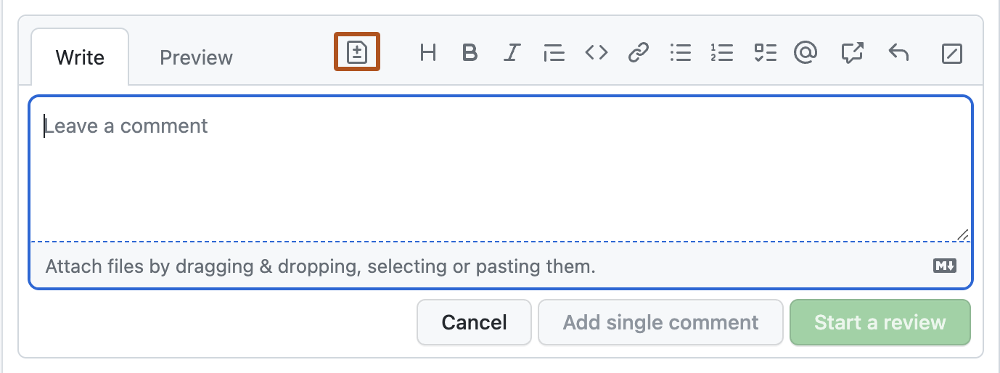
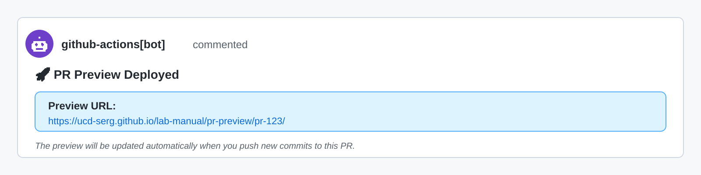

# Collaborative Software Development

Code

Published

Last modified: 2026-10-10 00:37:13 (PDT)

This chapter covers the social side of writing code together: opening pull requests, reviewing each other’s work, and responding to review feedback.

## 1 Pull Requests

### 1.1 Pull request roles

Every pull request involves several people, each with a distinct role.

#### Issue Creator

The issue creator reports a bug, suggests a feature, or requests other improvements. In projects with external contributors, the issue creator often cannot assign issues to developers and is typically distinct from the PR author.

#### Author

The author opens the PR, writes a clear description, and links it to the relevant issue with `Closes #N` in the PR body. The author implements review feedback and resolves merge conflicts before re-requesting review.

#### Reviewer

The reviewer reads the diff, checks the code for correctness and style, and either approves or requests changes.

#### Merger

The merger executes the final merge once the PR is approved and all CI checks pass. This is often the same person as the reviewer.

#### Assignee

The assignee is listed in the “Assignees” field on GitHub to indicate who is currently responsible for the PR. This field clarifies ownership and tracks who should be addressing open feedback.

#### PR Steward

A PR steward keeps the review queue healthy. The steward monitors open PRs, assigns reviewers when none are assigned, follows up on stalled reviews, and helps resolve disagreements between authors and reviewers. This is typically a rotating duty for a senior contributor or release manager. The p5.js project documents how it structures this role in its [steward guidelines](https://p5js.org/contribute/steward_guidelines/).

### 1.2 Opening pull requests

#### Write focused PRs

A focused pull request is **one self-contained change** that addresses just one thing. Writing focused PRs has several benefits:

- **Faster reviews**: It is easier for a reviewer to find 5-10 minutes for a single bug fix than to set aside an hour for one large PR.
- **More thorough reviews**: Large PRs can overwhelm reviewers, which makes it easier to miss important problems.
- **Fewer bugs**: Smaller changes are easier to reason about.
- **Easier merges**: Large PRs take longer and are more likely to develop merge conflicts.
- **Less wasted work**: If the overall direction is wrong, you lose less time on a small PR than on a large one.

As a guideline, 100 lines is usually a reasonable size for a PR, and 1000 lines is usually too large. The number of files matters too: a 200-line change in one file might be fine, but the same change spread across 50 files is usually too large.

#### Write clear PR titles and descriptions

When you submit a pull request, include a detailed title and description. A comprehensive description helps the reviewer and provides valuable historical context.

**PR title:** The title should be a short summary, ideally under 72 characters, that is specific enough for future developers to understand the change without opening the full PR.

Poor titles that lack context:

- “Fix bug”
- “Add patch”
- “Moving code from A to B”

Better titles that summarize the actual change:

- “Fix missing value handling in data processing function”
- “Add support for custom date formats in import functions”

**PR description body:** The description should give the reviewer the context they need to understand the change. Consider including:

- A brief description of the problem being solved
- Links to related issues, such as `Closes #123` or `Related to #456`
- A before-and-after example that shows the changed behavior
- Possible shortcomings or trade-offs in the current approach
- For complex PRs, a suggested reading order for the reviewer

The **Files changed** tab on GitHub also lets you add inline comments that explain non-obvious changes. Those notes live in the PR metadata, not in the source files, so they are a good place to explain *this change* without cluttering the code with temporary rationale.

#### Explain technical reasoning up front

For non-obvious technical decisions, proactively explain your reasoning in commit messages and PR descriptions. Do not make reviewers ask why you chose a particular approach.

Common situations that require explanation:

- **Version pinning**: Explain whether you are using floating tags (for example `@v2`), version tags (for example `@v2.9.4`), or commit SHA pins (for example `@abc1234...`) and why. For example: “Using `@v2` (moving tag) to receive bug fixes within the major version while maintaining stability.”
- **Configuration changes**: Explain the rationale behind non-obvious choices, such as why a boolean is set a certain way.
- **Dependency updates**: Explain why you are updating and what benefit or fix it brings.
- **Workflow modifications**: Describe the problem you are solving and why this approach is preferred.

This proactive communication reduces review back-and-forth and helps future maintainers understand the decision later.

#### Request reviews in the right order

Before requesting a pull request review from the PIs, obtain fresh approvals from:

- at least one other student
- at least one AI reviewer

This requirement applies both to the initial PI review request and to later re-review requests after revisions.

When requesting a review (whether in Microsoft Teams, email, or GitHub), always provide a direct hyperlink to the pull request (see [Direct Hyperlinks in Internal Correspondence](https://ucd-serg.github.io/lab-manual/communication.html#sec-direct-hyperlinks)). Do not make reviewers search for the PR they are asked to review.

#### Include tests with behavior changes

Focused PRs should include related test code. A PR that adds or changes logic should add or update tests for the new behavior. Pure refactoring PRs should also be protected by tests. If tests do not already exist for code you are refactoring, add them in a separate PR first to confirm that behavior stays unchanged.

#### Separate refactorings from feature work

It is usually best to do refactorings in a separate PR from feature changes or bug fixes. For example, moving and renaming a function should generally be separate from fixing a bug in that function. That separation makes it much easier for reviewers to understand what each PR actually changes.

Small cleanups, such as a local variable rename, can travel with a feature or bug fix. Large refactorings should not.

#### Standardize PR descriptions with a template

GitHub lets you create a pull request template in a repository so everyone starts with the same PR body structure.

To add one:

1.  On GitHub, navigate to the main page of the repository.
2.  Above the file list, click `Create new file`.
3.  Use one of GitHub’s recognized pull request template locations: `pull_request_template.md` or `PULL_REQUEST_TEMPLATE.md` in the repository root, `.github/`, or `docs/`. For multiple templates, use `.github/PULL_REQUEST_TEMPLATE/`. See [GitHub’s pull request template documentation](https://docs.github.com/en/communities/using-templates-to-encourage-useful-issues-and-pull-requests/creating-a-pull-request-template-for-your-repository).
4.  Add the template content to the file on the default branch.

Here is an example template:

``` text
# Description

## Summary of change

Please include a summary of the change, including any new functions added and example usage.

## Related Issues

Closes #(issue number)
Related to #(issue number)

## Testing

Describe how this change has been tested.

## Checklist

- [ ] Tests added/updated
- [ ] Documentation updated
- [ ] Code follows project style guidelines

## Who should review the pull request?

@username
```

#### Stacked pull requests

When implementing a sequence of interdependent features or multi-stage refactorings, stack pull requests to keep each change small and focused (see [Section 1.3](#sec-stacked-pull-requests) for detailed stack creation, CI, and merging guidelines).

### 1.3 Stacked pull requests

#### What are stacked pull requests?

A stacked pull request workflow breaks large or multi-step code changes into a linear chain (or stack) of smaller, dependent pull requests ([“About Stacked Pull Requests,” n.d.](#ref-githubstackedprs)).

In a pull request stack:

- The bottom pull request targets the repository default branch (typically `main`).
- Each subsequent pull request targets the branch of the pull request immediately below it.

``` text
 +-- feat/frontend-ui    -> PR #3 (base: feat/api-endpoints) [top]
 +-- feat/api-endpoints  -> PR #2 (base: feat/auth-layer)
 +-- feat/auth-layer     -> PR #1 (base: main)               [bottom]
main (default base branch)
```

Each pull request in the stack isolates the diff for its specific layer, displaying only the changes between its branch and the layer beneath it.

#### Benefits of stacked pull requests

Stacked pull requests provide several practical advantages:

- **Unblocked continuous development**: You can begin and publish changes that build upon unmerged work without waiting for prior pull requests to complete review.
- **Smaller, faster code reviews**: Reviewers inspect focused, self-contained layers instead of reviewing an overwhelming monolithic diff.
- **Structured dependency tracking**: Foundational changes (such as database schemas, data structures, or shared utilities) live in lower layers, while dependent features (such as API endpoints, UI components, or specialized tests) live in higher layers.
- **Agent and high-volume compatibility**: When coding agents or developers generate modular increments in sequence, stacks give each logical task a dedicated, isolated pull request.

#### Core principles for stacking

When using stacked pull requests, follow these guidelines:

- **Enforce dependency order**: If code in one layer relies on code from another, that dependency must reside in the same branch or a lower branch in the stack.
- **Split at distinct concerns**: Start a new layer whenever shifting to a different concern (for example, moving from core data models to analysis scripts, or from backend logic to documentation and tests) or when the diff exceeds reviewable size guidelines.
- **Keep branches in the same repository**: Stacked pull requests require all branches to live in the same repository; cross-fork stacks are not supported.

#### CI, rebasing, and merging

GitHub provides native platform support for managing and merging pull request stacks:

- **Rules and CI enforcement**: Branch protection rules (such as required approvals) and GitHub Actions CI checks configured for the base branch (`main`) automatically apply to every pull request in the stack, ensuring consistent quality across every layer.
- **Bottom-up merging**: Pull requests merge in sequential order from the bottom up. When the bottom-most pull request merges into the default branch, the pull request immediately above it automatically retargets onto the default branch so each successive layer can land cleanly in turn.
- **Automated cascading rebases**: When lower branches in a stack are updated with review revisions or upstream changes, rebasing or merging those updates propagates them upward through dependent branches to keep the entire stack in sync and resolve conflicts early.

## 2 Code Review

### 2.1 Reviewing pull requests

When submitting code to colleagues or reviewing theirs, use practices that keep feedback constructive and specific. The [Tidyverse code review principles](https://code-review.tidyverse.org/) ([Tidyverse Team 2023](#ref-tidyverse2023codereview)) are a strong baseline for R projects. As noted in the Tidyverse guide’s [acknowledgments](https://code-review.tidyverse.org/#acknowledgements), the guide is a modified fork of [Google’s Code Review Developer Guide](https://google.github.io/eng-practices/review/).

#### Purpose of code review

The primary purpose of code review is to improve the overall code health of the project over time. Reviewers should balance the need to make forward progress with the need to maintain code quality.

The key principle is to approve a PR once it clearly improves the codebase, even if it is not perfect. There is no such thing as perfect code. There is only better code.

#### Monitor PRs awaiting your review

To keep reviews moving, bookmark GitHub’s review-requested page and check it regularly, ideally at least daily:

- **General bookmark**: <https://github.com/pulls/review-requested> shows all PRs across GitHub where you have been requested as a reviewer.
- **Project-specific bookmark**: for frequently reviewed repositories, bookmark the project-specific version. For this repository: <https://github.com/UCD-SERG/lab-manual/pulls/review-requested/YOUR-USERNAME> replacing `YOUR-USERNAME` with your GitHub username.

Checking these pages regularly helps keep PRs from languishing in the queue.

#### Write review comments that teach

When reviewing code, be courteous, clear, and helpful:

- Comment on the **code**, not the author.
- Explain **why** you are making a suggestion, referencing best practices, design patterns, or code health where appropriate.
- Balance problem finding with guidance, so the author can learn from the review.
- Highlight positive choices too, so good practices get reinforced.

**Poor comment:** “Why did you use this approach when there is obviously a better way?”

**Better comment:** “This approach adds complexity without clear benefits. Consider using \[alternative approach\] instead, which would simplify the logic and improve readability.”

#### Use review as mentoring

Code review is also a mentoring tool. As a reviewer:

- Leave comments that help authors learn something new.
- Link to relevant style guides or best-practice documentation.
- For complex reviews, consider a live review or pair-programming session.

#### Balance direct fixes with guidance

In general, the author is responsible for fixing the PR, not the reviewer. Point out problems clearly, but do not feel obligated to design every solution. Sometimes it is better to name the issue and let the author work out the implementation details.

For very small tweaks, such as typo fixes or comment additions, use GitHub’s suggestion feature so the author can accept the change directly in the UI.

[](../assets/images/github-suggestion-feature.png "Figure 1: GitHub’s suggestion feature in a PR review comment")

Figure 1: GitHub’s suggestion feature in a PR review comment

#### Ignore auto-generated files when appropriate

When reviewing pull requests in R package repositories, you can usually ignore `.Rd` files in `man/`. These files are generated automatically by [`{roxygen2}`](https://roxygen2.r-lib.org/) from roxygen comments in the source.

Why ignore `.Rd` files?

- They are generated files and should never be edited by hand.
- Their changes are already visible in the roxygen comments in the `.R` source files.
- Reviewing the source comments is more informative than reviewing the generated output.
- The files will be regenerated during the package build process.

What to review instead:

Review the roxygen comments in the `.R` source files. These begin with `#'` and appear immediately before function definitions.

If the repository has a preview workflow such as `pkgdown` or Quarto, review the rendered preview as well. The workflow should post a PR comment with a link to the preview build.

[](../assets/images/quarto-preview-comment.png "Figure 2: Example of an automated PR preview comment posted by GitHub Actions")

Figure 2: Example of an automated PR preview comment posted by GitHub Actions

In GitHub’s **Files changed** view, you can click the three dots (`...`) next to a file and choose **View file** to hide it from the diff. That helps you focus on the meaningful changes.

#### Reviewing Copilot-generated pull requests

Review pull requests created by GitHub Copilot coding agents using the same standards as any other PR, but watch for a few agent-specific issues.

**Workflow approval requirements:**

- You must manually approve GitHub Actions workflows for Copilot PRs.
- This is a security measure because Copilot can modify any file, including workflow files.
- Approve the workflow from the Actions tab or from the PR interface to start the checks.
- As of 2026-07-21, this manual approval step cannot be bypassed, including by repository owners.

**Review focus areas:**

- Verify that the solution actually addresses the issue.
- Check for over-engineering or extra features that were not requested.
- Review the test coverage for relevance and completeness.
- Check whether documentation is clear and follows repository conventions.
- Look for missed edge cases or incomplete error handling.

**Iterating on Copilot PRs:**

When you find issues in a Copilot PR, you can either:

1.  Leave review comments and ask Copilot to address them.
2.  Push commits directly to the Copilot PR branch yourself.

Direct edits are often faster for small fixes such as typos, formatting, or tiny adjustments.

Best practices:

- Do not push while Copilot is actively working on the branch.
- Review incrementally if the PR is large and the agent is updating it in stages.
- Trust the tool, but always verify the result with human review.

### 2.2 Responding to review comments

Once you receive a review from a human reviewer, you are obligated to respond promptly: typically within a week, unless there are extenuating circumstances. Address each of the reviewer’s comments individually. You aren’t obligated to agree with every comment; you are entitled to ask clarifying questions, raise objections, or ask to defer it to a later pull request.

When a reviewer leaves a comment on your code, respond to each one with exactly one of these:

- **Address it.** Make the change the reviewer asked for.
- **Rebut it.** If you think the code is correct as written, explain your reasoning and push back. You can disagree—just say why.
- **Defer it.** If the comment is valid but out of scope for this change, file a tracking issue, assign it to yourself (or delegate it, if applicable), and link it in your reply so the reviewer can see you are taking their concern seriously. This keeps the work visible and ensures it is not lost.
- **Acknowledge it.** For a comment that needs no action, a short acknowledgment is enough.

Never ignore a review comment. Always reply—even if only to say you filed a follow-up issue.

#### Resolving review comment threads

Before requesting a new review round, resolve every comment thread whose underlying item is settled:

- **When addressing an item:** Resolve the thread after pushing the commit that implements the fix. Include the commit hash in your thread reply so the reviewer can trace the change.
- **When deferring an item:** Resolve the thread after creating the tracking issue and linking it in your reply.
- **When acknowledging an item:** Resolve the thread after posting a brief acknowledgment.
- **When rebutting an item:** Leave the thread open initially with your explanation and evidence. If the reviewer agrees or does not re-raise the item in the subsequent round, resolve the thread.

If you need the reviewer to weigh in or clarify a specific point, leave that thread open and state explicitly in your reply that you are awaiting their guidance.

### 2.3 Avoid closing and restarting pull requests

Avoid closing a pull request and “starting over” on the same issue. Doing so disrupts the conversation between authors and reviewers, creates confusion, and leads to repeated work. Instead, keep iterating on the open pull request, where the review history stays attached to the code it discusses.

Back to top

## References

“About Stacked Pull Requests.” n.d. GitHub. <https://docs.github.com/en/pull-requests/get-started/about-stacked-prs>.

Tidyverse Team. 2023. *Tidyverse Code Review Principles*. <https://code-review.tidyverse.org/>.
